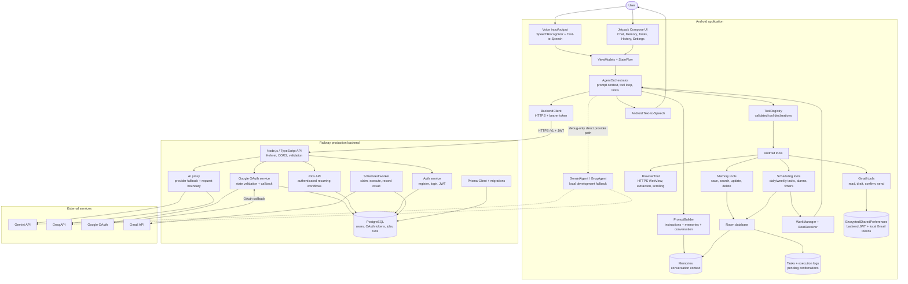

# Architecture

## Detailed system architecture



### Main request sequence

```text
1. User enters text or speech.
2. Compose sends the command to the ViewModel.
3. AgentOrchestrator retrieves relevant Room memories.
4. PromptBuilder creates the bounded agent prompt.
5. BackendClient sends the request to Railway with the user's JWT.
6. Backend proxy calls Gemini or Groq; provider keys stay on Railway.
7. The model returns a final answer or a declared tool call.
8. Android validates and executes the tool locally.
9. Tool results return to the bounded agent loop.
10. The final response is displayed, optionally spoken, and logged.
```

### Scheduled task sequence

```text
Task creation
  -> SchedulerTool validates instruction and time
  -> Room persists the task
  -> WorkAgentScheduler registers unique WorkManager work
  -> BootReceiver restores enabled work after reboot
  -> AgentWorker loads the task and calls AgentOrchestrator
  -> ExecutionLogRepository records success/failure
  -> Notification reports the outcome

Production backend jobs
  -> POST /v1/jobs persists a PostgreSQL job
  -> Railway worker claims due rows with row locking
  -> Worker executes the job and records ScheduledJobRun
```

### Trust boundaries

| Boundary | Protection |
|---|---|
| Android to Railway | HTTPS and bearer JWT authentication |
| Android local storage | Room for application data; encrypted preferences for tokens |
| Railway to AI providers | Provider keys exist only in Railway variables |
| Railway to Google | Server-side OAuth client and encrypted Gmail tokens |
| Model to Android tools | Tool names and arguments are validated before execution |
| Email sending | Draft preparation is separate from explicit confirmation |
| Web browsing | HTTPS-only URLs, redirect checks, timeout, and output cap |

```text
Android client
  Compose UI
    -> ViewModels / StateFlow
    -> AgentOrchestrator
    -> Memory repositories / ToolRegistry / Room
    -> WorkManager AgentWorker
    -> Text-to-Speech / controlled HTTPS WebView

Production path
  Android client
    -> HTTPS + bearer session
    -> Node.js backend
       -> Gemini/Groq provider APIs
       -> Google OAuth + encrypted Gmail tokens
       -> PostgreSQL + Prisma
       -> scheduled-job worker
```

## Production boundary

The [`backend/`](../backend/) service is the production boundary for multi-user
authentication, AI provider calls, Google OAuth, encrypted Gmail tokens, and server-side
scheduled jobs. When `AURA_BACKEND_URL` is configured, Android authenticates against
the backend and routes AI requests through `/v1/ai/generate`. The Android app keeps its
local Room/WorkManager path for device memory and local scheduled tasks; release
provider keys are blank.

## Agent flow

The orchestrator retrieves keyword-matching memories, sends the user command and tool declarations to Gemini, validates returned function calls, executes registered tools, and sends tool results back in a bounded loop. Five tool calls is the maximum per command, allowing bounded multi-step workflows such as retrieving important email and then summarizing it.

The model does not directly access Android APIs. It selects a registered tool,
the orchestrator validates its arguments, the tool runs, and the result is
returned to the model. The loop ends when the model produces a final response
or the call limit is reached.

## Voice-to-action pipeline

1. Android requests microphone permission.
2. `SpeechRecognizerManager` converts speech to text.
3. The text is sent through `ChatViewModel`.
4. The orchestrator selects and executes tools.
5. The assistant response is displayed and optionally spoken by Android
   Text-to-Speech.

Email tools are confirmable. Gemini can prepare a draft, but the send operation only occurs after the user presses the confirmation button. Pending drafts are persisted in Room so process death does not silently lose an approval request.

## Scheduling

`ScheduleParser` accepts daily and weekly phrases such as `Every day at 9 AM` and `Every Monday at 10 AM`. Tasks are persisted in Room and scheduled as unique periodic WorkManager work. The validated `schedule_task` tool uses the same repository and scheduler as the Tasks screen. `AgentWorker` executes the saved instruction through the same bounded orchestrator, writes an execution log, and posts the outcome as a notification. `BootReceiver` re-registers enabled tasks after a device restart. Android may defer WorkManager execution; the application does not promise exact wall-clock execution.

## Security and errors

API keys are loaded from ignored `local.properties`. Gmail tokens are stored with encrypted preferences.
The browser only accepts HTTPS URLs, blocks non-HTTPS redirects, limits page extraction to
12,000 characters, and times out after 15 seconds. JavaScript is enabled only inside the temporary
WebView because many modern pages require it for rendering; no page interaction or credentials are
exposed to the agent. API, tool, worker, and repository failures are surfaced as errors and written
to execution history where applicable.
